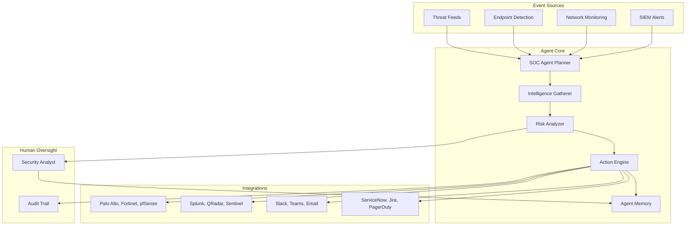

# ThreatSentinel SOC Agent

[](https://github.com/MohibShaikh/ThreatSentinel/actions/workflows/ci.yml)

An autonomous first responder for security operations. ThreatSentinel investigates security events on its own: it pulls threat intelligence, scores risk, executes response actions through your existing tools, and writes the report. Built for teams without a dedicated SOC, and for SOC teams drowning in alerts.

## From alert to action

Your SIEM flags `203.0.113.100` after 50 failed logins in 2 minutes.

Without an agent: page an analyst, wait, research the IP manually, assess risk, write a report, act. Hours later.

With ThreatSentinel: the event goes in, the agent queries VirusTotal, AbuseIPDB, URLVoid, and its own memory, scores the risk, blocks the IP through your firewall, alerts Slack, and files the report. About 30 seconds.

## Architecture

```
ThreatSentinel/
├── agent/                    # Core agent logic
│   ├── planner.py            # Investigation pipeline and decisions
│   ├── tools.py              # Tool definitions: Shodan, VirusTotal, etc.
│   ├── memory.py             # SQLite memory with pattern detection
│   ├── reporter.py           # Generates final incident report
│   ├── task_queue.py         # Priority queue with persistence
│   ├── action_logger.py      # Action logging and audit
│   ├── llm.py                # Optional LLM analysis providers
│   └── integrations/         # SOC tool integrations
│       ├── base.py           # Abstract base for all integrations
│       ├── firewall.py       # Palo Alto, Fortinet, pfSense
│       ├── siem.py           # Splunk, QRadar, Azure Sentinel
│       ├── communication.py  # Slack, Teams, Email
│       ├── incident.py       # ServiceNow, Jira, PagerDuty
│       └── registry.py       # Central integration orchestrator
│
├── backend/                  # FastAPI backend
│   ├── main.py               # API server + lifespan management
│   ├── deps.py               # Shared dependencies (auth, agent instance)
│   ├── routes/
│   │   ├── investigations.py # Investigation management
│   │   ├── reports.py        # Report generation/retrieval
│   │   ├── monitoring.py     # Metrics and health
│   │   ├── integrations.py   # Integration management
│   │   ├── tasks.py          # Task queue management
│   │   └── audit.py          # Audit and compliance
│   ├── models.py             # Pydantic models
│   └── config.py             # pydantic-settings configuration
│
├── frontend/                 # React dashboard
├── tests/                    # Unit tests
├── .github/workflows/ci.yml  # CI: Python 3.10-3.12, lint, Docker
├── Dockerfile
├── docker-compose.yml
├── requirements.txt
├── main_api.py               # API entry point
└── env_template              # Environment variables template
```

## How it works

Each investigation runs through six phases:

1. **Initial assessment.** Classify the event, check memory for similar past events.
2. **Intelligence gathering.** Query IP, URL, and file reputation sources in parallel.
3. **LLM analysis** (optional). If an LLM key is configured, a provider reasons over the collected evidence.
4. **Risk analysis.** Weighted score from base severity, intel results, historical patterns, and the LLM modifier when present.
5. **Action planning and execution.** Pick responses, then execute them through configured integrations. High-risk cases go to human review instead, unless emergency mode is on.
6. **Report and memory.** Write the report, store the outcome so future investigations get smarter.



## Supported event types

| Event type | Description | Example |
|------------|-------------|---------|
| suspicious_ip | IPs showing malicious behavior | Brute force, scanning |
| suspicious_url | Potentially malicious websites | Phishing, malware distribution |
| malware_detection | File-based threats | Trojans, ransomware |
| login_anomaly | Unusual authentication patterns | Compromised accounts |
| ddos_signs | Denial of service indicators | Availability attacks |
| phishing_attempt | Social engineering | Credential theft by email |

## Quick start

```bash
git clone https://github.com/MohibShaikh/ThreatSentinel.git
cd ThreatSentinel

# uv recommended, pip works too
uv venv && source .venv/bin/activate
uv pip install -r requirements.txt

# Or:
# python -m venv .venv && source .venv/bin/activate
# pip install -r requirements.txt
```

Or with Docker:

```bash
docker compose up -d
# API at http://localhost:8000, frontend at http://localhost:3000
```

Configure:

```bash
cp env_template .env
# Add API keys if you have them. Threat intel lookups fail with a clear
# error until their key is set; no fake data is ever substituted.
# VIRUSTOTAL_API_KEY=...
# ABUSEIPDB_API_KEY=...
# URLVOID_API_KEY=...
```

Launch:

```bash
python main_api.py
```

Then submit your first investigation at http://localhost:8000/docs, or:

```bash
curl -X POST "http://localhost:8000/api/v1/investigations/" \
  -H "Authorization: Bearer $SECRET_KEY" \
  -H "Content-Type: application/json" \
  -d '{
    "event_data": {
      "event_type": "suspicious_ip",
      "source_ip": "203.0.113.100",
      "payload": {
        "failed_login_attempts": 25,
        "accessed_endpoints": ["/admin", "/login"],
        "time_window": "10 minutes"
      }
    },
    "emergency_mode": false
  }'
```

Poll `GET /api/v1/investigations/{id}/result` for the completed report.

## API endpoints

### Investigations
- `POST /api/v1/investigations/` - submit an event
- `GET /api/v1/investigations/{id}` - status and progress
- `GET /api/v1/investigations/{id}/result` - full results
- `POST /api/v1/investigations/bulk` - batch submission
- `POST /api/v1/investigations/search` - search history

### Reports
- `POST /api/v1/reports/generate` - generate a formatted report
- `GET /api/v1/reports/{report_id}` - report content
- `GET /api/v1/reports/{report_id}/download` - download as file
- `GET /api/v1/reports/` - list reports

### Monitoring
- `GET /api/v1/monitoring/metrics` - current metrics
- `GET /api/v1/monitoring/metrics/history` - time-series data
- `WebSocket /api/v1/monitoring/metrics/stream?token=SECRET_KEY` - live stream
- `GET /api/v1/monitoring/system/status` - detailed system status

### Health
- `GET /health` - health check
- `GET /api/v1/stats` - agent statistics

### Tasks
- `POST /api/v1/tasks/` - create a prioritized task
- `GET /api/v1/tasks/{task_id}` - task status
- `DELETE /api/v1/tasks/{task_id}` - cancel a task
- `GET /api/v1/tasks/` - queue statistics
- `POST /api/v1/tasks/queue/start` and `/stop` - control workers
- `POST /api/v1/tasks/queue/cleanup` - remove old tasks

### Audit
- `GET /api/v1/audit/investigations/{id}/logs` - logs for one investigation
- `GET /api/v1/audit/investigations/{id}/timeline` - timeline view
- `GET /api/v1/audit/investigations/{id}/export` - export the audit trail
- `GET /api/v1/audit/system/health` - system-wide health
- `GET /api/v1/audit/components/{component}/performance` - per-component metrics
- `GET /api/v1/audit/logs/search` - search action logs

### Integrations
- `GET /api/v1/integrations/` - list configured integrations
- `POST /api/v1/integrations/{name}/test` - test connectivity
- `POST /api/v1/integrations/actions/execute` - execute one action
- `POST /api/v1/integrations/actions/bulk` - execute several
- `GET /api/v1/integrations/capabilities/{action_type}` - who can do what
- `GET /api/v1/integrations/health` - health-check everything

Every `/api/v1` route requires a bearer token matching `SECRET_KEY`; the websocket stream takes the same value as a `token` query parameter. With `DEBUG=true`, unauthenticated requests run as an admin user, which is convenient locally and dangerous anywhere else.

## Risk scoring

Without an LLM configured:

```
final = base*0.30 + threat_intel*0.50 + pattern*0.20
```

With an LLM modifier:

```
final = base*0.20 + threat_intel*0.35 + pattern*0.15 + llm_modifier*0.30
```

Levels: low below 0.3, medium to 0.6, high to 0.8, critical above. Investigations above 0.8, or with low confidence, escalate to human review automatically.

## Integrations

| Category | Tools | Actions |
|----------|-------|---------|
| Firewalls | Palo Alto, Fortinet, pfSense | Block IP/URL/domain, create rules |
| SIEM | Splunk, QRadar, Azure Sentinel | Incidents, rules, watchlists |
| Communication | Slack, Teams, Email | Alerts, notifications, escalations |
| Incident response | ServiceNow, Jira, PagerDuty | Tickets, alerts, escalations |

Configure them through the `INTEGRATIONS_CONFIG` environment variable as JSON:

```bash
INTEGRATIONS_CONFIG='{"integrations": {"palo_alto": {"hostname": "firewall.company.com", "api_key": "..."}}}'
```

Execute an action directly:

```bash
curl -X POST "http://localhost:8000/api/v1/integrations/actions/execute" \
  -H "Authorization: Bearer $SECRET_KEY" \
  -H "Content-Type: application/json" \
  -d '{"action_type": "block_ip", "target": "203.0.113.100", "context": {"reason": "Malware C2"}}'
```

When an investigation finishes, the planner can execute recommended actions through this same registry, so API-driven and autonomous actions share one code path and one audit log.

## Human oversight

Investigations escalate to review when risk crosses 0.8, confidence drops below 0.5, critical infrastructure is involved, or unknown indicators pile up. Emergency mode skips the wait and acts immediately, which is exactly what you want during an active attack and exactly what you don't want by accident.

Analyst feedback closes the loop: accuracy ratings adjust future confidence thresholds, false positive marks teach memory to stop repeating mistakes, and missed indicators feed back into detection.

## Security notes

Store credentials in environment variables, never in code. Every `/api/v1` route requires a bearer token, CORS is an explicit allowlist (`CORS_ORIGINS`), and report IDs are validated before any filesystem access. Firewall and SIEM targets are validated too: only real IP addresses, domains, and plain indicators reach PAN-OS XML, FortiOS, Splunk SPL, or Sentinel KQL. The audit trail records every investigation action with timestamps and outcomes. Basic analysis works offline when external APIs are unreachable. Read `env_template` before deploying; the defaults exist for local development only.

## Development

```bash
export DEBUG=true
python main_api.py            # auto-reload dev server
pytest tests/ -v              # unit tests
LOG_LEVEL=DEBUG python main_api.py
```

API docs live at http://localhost:8000/docs and http://localhost:8000/redoc.

To extend: add event types in `backend/models.py`, tools in `agent/tools.py`, endpoints under `backend/routes/`, integrations under `agent/integrations/`.

## License

MIT. See the LICENSE file for details.
